# Screenshots

Every page of the desktop app, drawn from made-up data: nothing here is a real account, folder or file. They are not captured by hand. `scripts/screenshots.sh` has the app draw each page from example scenes and write the PNGs (see [Regenerating](#regenerating)), so they can be remade whenever the app changes.

## Activity

The home page. A banner says what the app is doing right now, and below it the files in flight and the recent feed of uploads, downloads and deletes, each with the folder it belongs to and when it happened.

While a sync runs, the banner shows the file being transferred and the files in flight are listed above the feed:

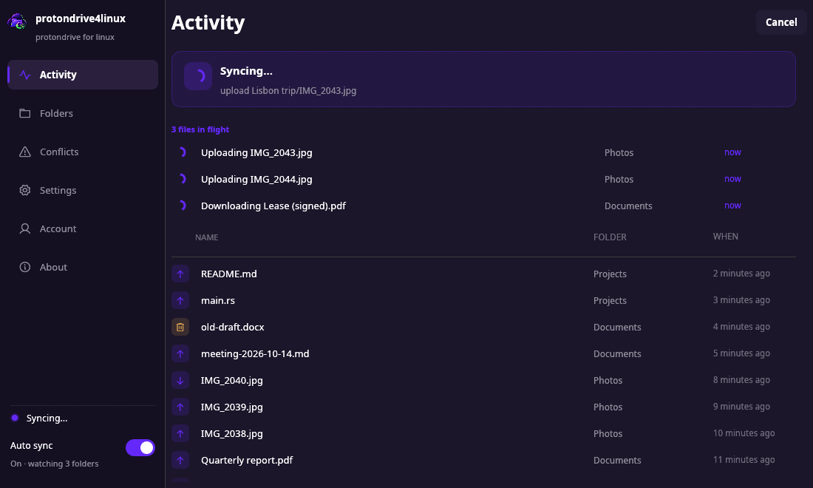

With Auto sync on and nothing in flight, the banner says what is being watched and how many files are in sync:

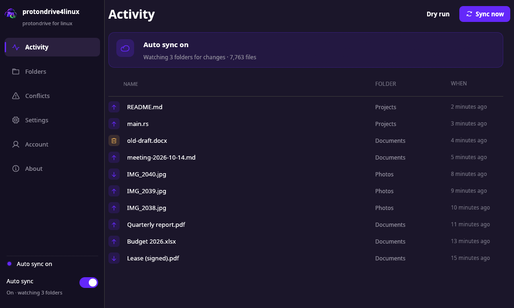

## Folders

One card per folder pair: the local folder, the Proton Drive folder, its state and how many files are in sync, an Auto switch for live sync, a Sync button for a one-off run, and the selective-sync picker. A syncing pair shows how far along it is (`Syncing… 37 of 120`) and a progress bar; files that failed and are waiting out their retry delay are counted in amber.

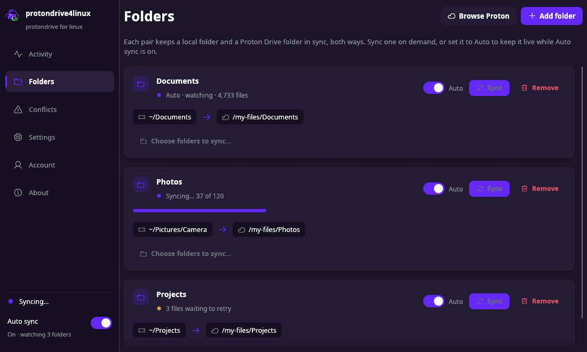

## Conflicts

Every file that changed on both sides since the last sync, and what was done about each. By default both versions are kept, so nothing is ever deleted to settle one; a conflict set to be skipped is left untouched until you decide.

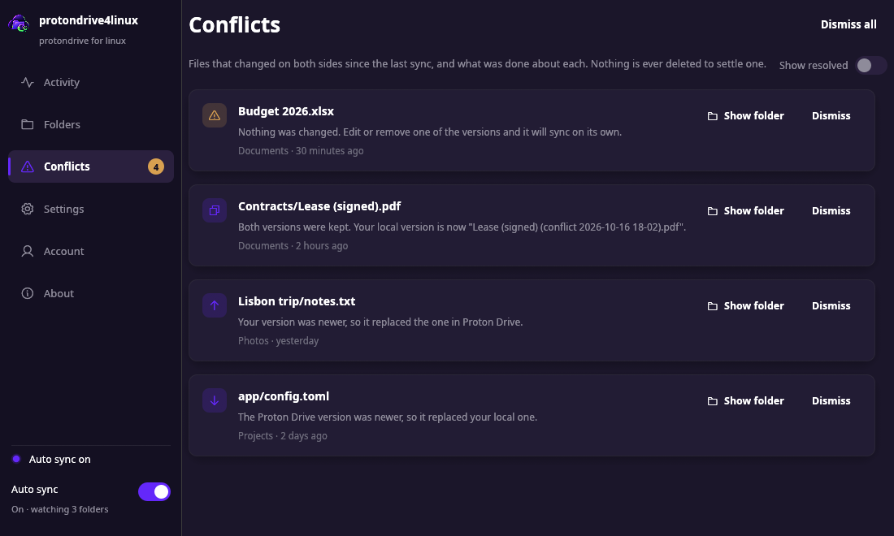

## Settings

Grouped cards: appearance (follow the desktop, light, dark, or a theme of your own), the file manager integration, the tray, notifications, launch at login, deletions, conflict handling, bandwidth and updates.

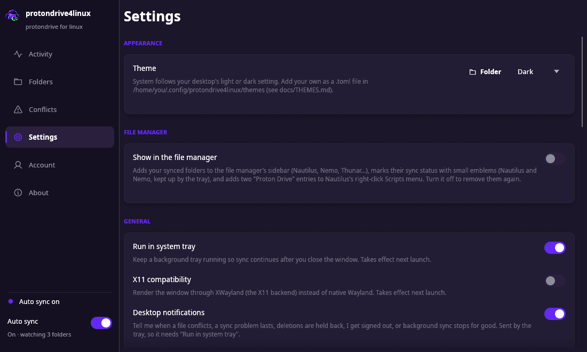

## Account

The `proton-drive` CLI in use and whether it has a session. protondrive4linux never sees your password: signing in is the CLI's own login, in your browser.

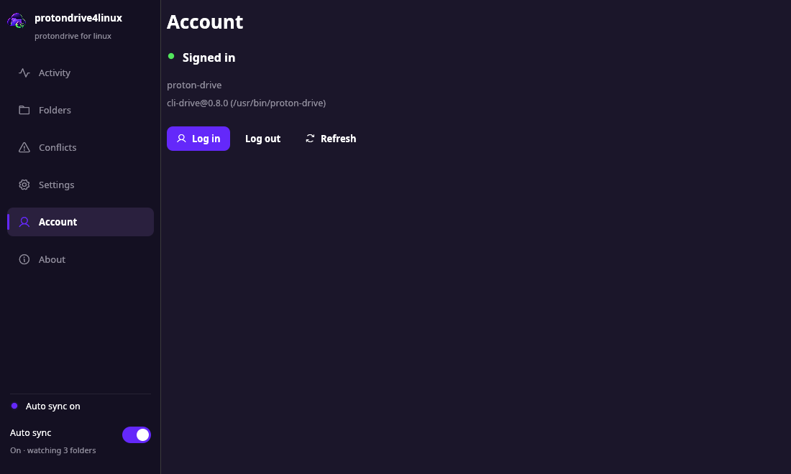

## Signing in

What a fresh install shows until the CLI has a session.

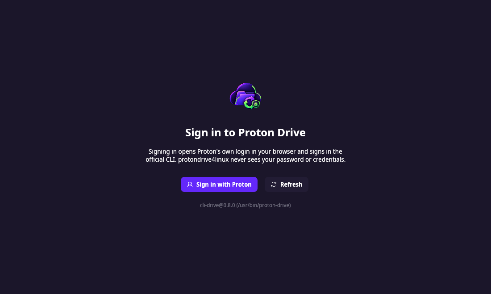

When the CLI has a session but can't reach the keyring it is kept in (the keyring is locked, or none is running in this session), the app does not ask you to sign in, because that would not help. It waits, and carries on by itself once the keyring answers:

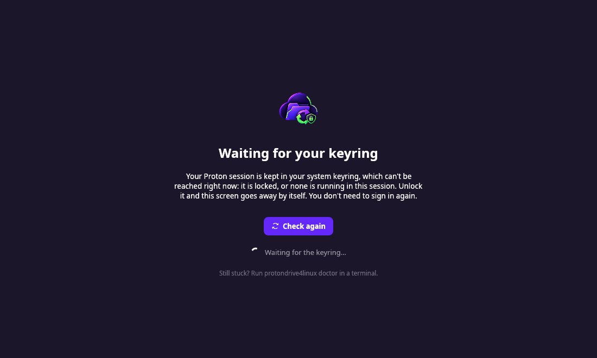

## Deletions held back

When one run would delete far more than anyone deletes by hand - more than 100 files and more than 20 % of what a folder holds, by default - protondrive4linux deletes **nothing** and asks. That is almost always a mistake (a drive that wasn't mounted, a folder emptied by accident), and the banner says how many files, how much of the folder, which side they would have been removed from, and that nothing was deleted. **Restore them** brings the files back (both sides are merged afresh and nothing is deleted); **Delete them** is for when it was on purpose, asks first, and says the files go to Proton's trash or your own, where they can still be restored. The folder's card says "N deletions held back" in amber, and the tray sends one notification. The same two answers from a terminal: `protondrive4linux sync --resync NAME` and `protondrive4linux sync --allow-mass-delete NAME`.

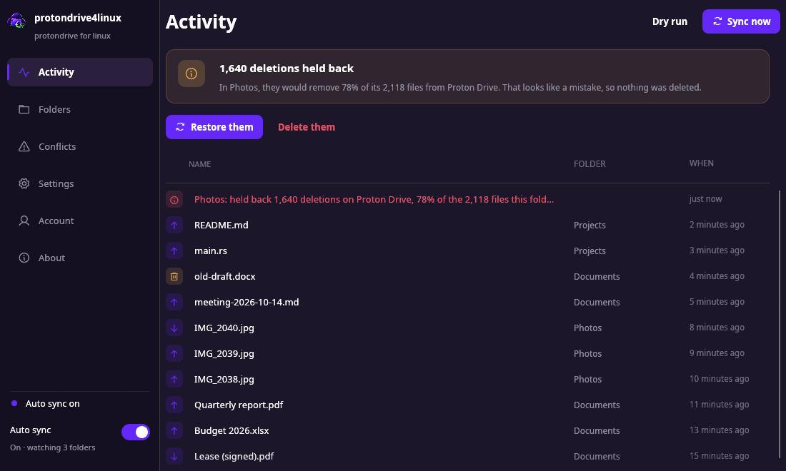

## Light theme

Settings → Appearance → Theme is **System** (follows the desktop's light/dark setting), **Light**, **Dark**, or any theme file you add (see [THEMES.md](THEMES.md)).

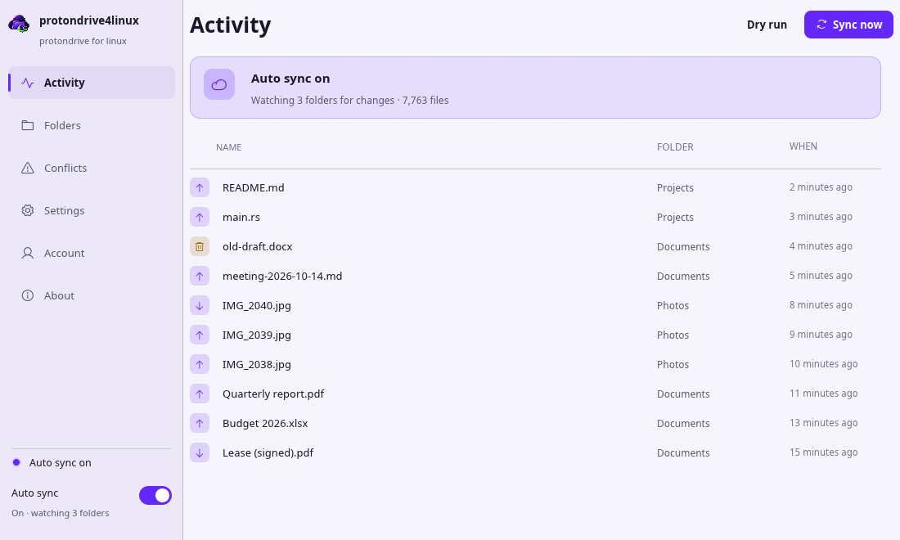
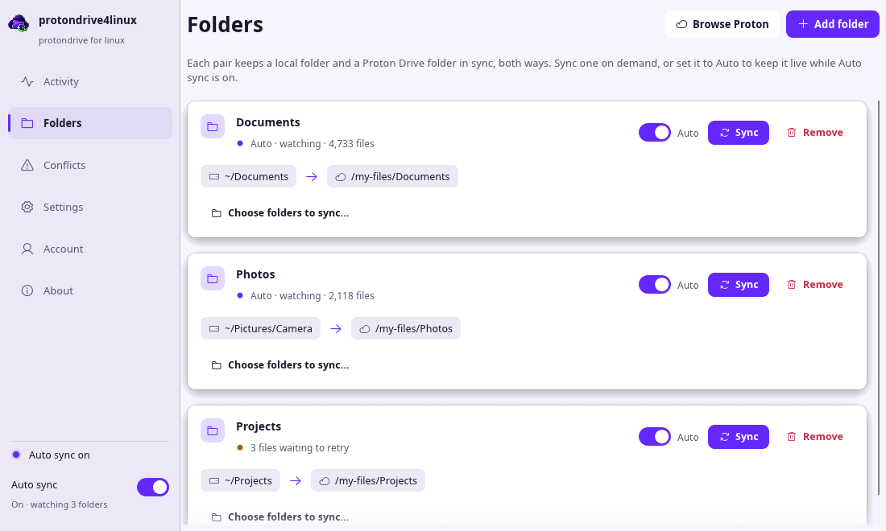
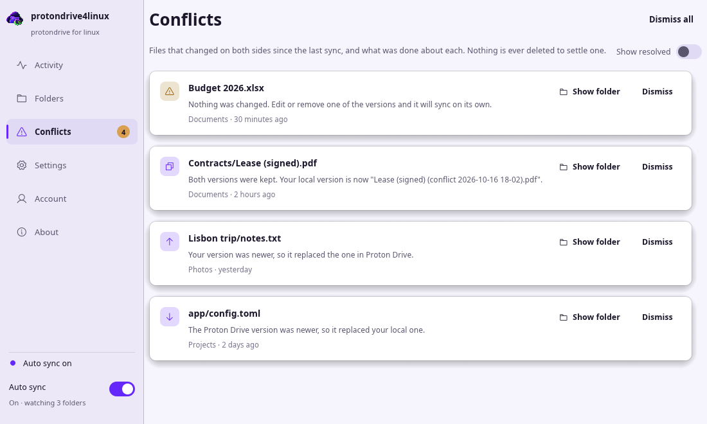

## Regenerating

```sh
scripts/screenshots.sh            # build (release, gui feature) and draw
scripts/screenshots.sh --hidpi    # twice the size, in a private X server (needs xvfb-run)
```

`protondrive4linux-gui --screenshots <folder>` is the app side: it builds its own configuration in memory with a CLI that isn't there, works in a scratch folder, and draws each scene in a fixed-size window; it never reads or writes your config, state, themes or desktop entries and never calls Proton. The script adds a scratch `HOME` on top, and runs it inside a private X server when `xvfb-run` is installed, so nothing flashes on your screen. Without one it uses your own X11 or XWayland session, and a window appears for a few seconds.

The scenes (what each page is made to show) are in `src/bin/gui/shots.rs`. When you add a page, add a scene for it; when a change alters how a page looks, run the script and commit the new pictures with it.
